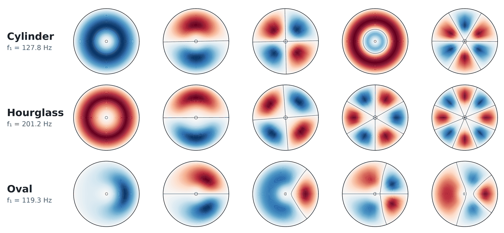
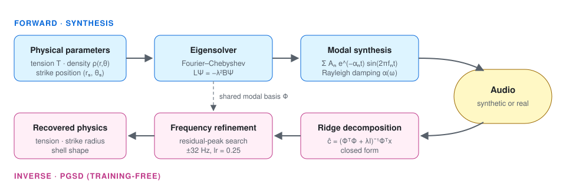

<div align="center">

# Interpretable Inverse Acoustic Modeling of Percussion via Physics-Guided Spectral Decomposition

**Rajeev Rajan · Kevin Benty · Athul Joe Joseph Palliparambil**

Government Engineering College Idukki (APJ Abdul Kalam Technological University) · Chalmers University of Technology

*Proceedings of the 27th International Society for Music Information Retrieval Conference (ISMIR 2026), Abu Dhabi, UAE*

[](https://ismir.net/)
[](paper/chenda_pgsd_ismir2026.pdf)
[](https://arcadehero3-eng.github.io/CHENDA_PGSD/)
[](requirements.txt)
[](LICENSE)



<sub>First five eigenmodes of three Chenda shell geometries at T = 3500 N/m. The oval shell breaks circular symmetry and lifts modal degeneracy.</sub>

</div>

---

## TL;DR

A **digital twin of the Chenda**, a South Indian percussion instrument, built from first principles.

- **Forward:** set membrane tension, density, and strike position. The model solves the membrane eigenproblem and synthesises the strike.
- **Inverse (PGSD):** give it a recording. It projects the audio onto the same physical modal basis and recovers **tension, strike position, and shell shape**.
- **No training data.** The modal amplitudes come from a closed-form ridge regression. Inference runs in under 0.5 s per strike on a laptop.

<p align="center"></p>

## Results at a glance

| Task (synthetic, 75 signals) | Result |
|---|---|
| Tension estimation, within ±14% of T<sub>ref</sub> | mean error **< 0.9%** for all shapes; Oval **0.32%** over the full range |
| Strike-position recovery | **0.3% × R ≈ 0.4 mm** for all shapes |
| Shell-shape identification | **3 / 3 correct**; R² matrix strongly diagonal |

**Real Chenda recordings (50 strikes: centre, edge, hand × 3 intensities)**

| Method | Type | Mean R² ↑ | MOS (1–5) ↑ |
|---|---|:---:|:---:|
| FFT peak tracking | spectral baseline | 0.45 | 2.49 ± 0.07 |
| Sinusoidal modelling | signal model | 0.59 | 3.08 ± 0.17 |
| NMF | data-driven | 0.41 | 1.86 ± 0.15 |
| **PGSD (ours)** | **physics-guided** | **0.70** | **3.69 ± 0.10** |

The best single strike reaches R² = 0.8152. Estimated strike radii match the labelled categories (centre 0.22 vs 0.20, hand 0.45 vs 0.46, edge 0.81 vs 0.75 in r/R).
All numbers come from the paper. MOS: 20 listeners, 50 files.

🎧 **Listen:** tension sweeps, strike positions, shell shapes and real-vs-reconstructed strikes are on the [audio demo page](https://arcadehero3-eng.github.io/CHENDA_PGSD/).

## Quick start

```bash
git clone https://github.com/arcadehero3-eng/CHENDA_PGSD.git
cd CHENDA_PGSD
python -m venv .venv && source .venv/bin/activate     # Windows: .venv\Scripts\activate
pip install -r requirements.txt

python src/generate_eigenmodes.py   # eigenmode figures (Fig. 2)          ~10 s
python src/chenda_pgsd_v3.py        # synthetic tasks: tension, position, shape   ~20 s
python src/baselines.py             # classical / MLP baselines                   ~8 min
```

All figures and logs go to `outputs/`. Set `PGSD_OUTPUT_DIR` to write somewhere else.

Real-recording analysis (Sec. 4.3, Table 5) lives in [`notebooks/chenda_pgsd_analysis.ipynb`](notebooks/chenda_pgsd_analysis.ipynb).

### Use it in your own code

```python
import runpy
pgsd = runpy.run_path("src/chenda_pgsd_v3.py", run_name="pgsd")

pgsd["set_experiment_mode"]("synthetic")
freqs, modes, alphas, r, th, rho = pgsd["get_spectral_basis"]("Oval", T=3500)
print(freqs[:5])          # modal frequencies in Hz
```

`set_experiment_mode("synthetic")` uses η₁ = 0.80 (Sec. 4.2). `"real"` uses η₁ = 1.087, calibrated on the recordings (Sec. 4.3).

## Repository layout

```
CHENDA_PGSD/
├── src/
│   ├── chenda_spectral.py       Fourier–Chebyshev eigensolver + shell density models
│   ├── chenda_pgsd_v3.py        forward model, PGSD decomposition, refinement, tasks
│   ├── generate_eigenmodes.py   eigenmode figures (Fig. 2)
│   ├── generate_spectrograms.py spectrograms of synthesised audio
│   ├── baselines.py             ESPRIT / HPS / FFT / NMF / MFCC-MLP baselines
│   └── baseline_experiment.py   baseline runs on the synthetic tasks
├── notebooks/                   real-recording analysis + baselines
├── audio/
│   ├── real_recordings/         segmented Chenda strikes (beat_N.wav)
│   ├── raw_strikes/             centre / edge / hand strikes, 3 intensities each
│   ├── reconstructed/           PGSD, sinusoidal, FFT and NMF reconstructions
│   └── synthesised/             forward-model audio (per shape + demo set)
├── figures/                     eigenmodes, geometry and result figures
├── docs/                        audio demo page (GitHub Pages) + guides
├── paper/                       camera-ready PDF + bibliography
└── assets/                      README images
```

## Method in four equations

Membrane eigenproblem with non-uniform density, solved on a Fourier–Chebyshev grid (N<sub>r</sub> = 25, N<sub>θ</sub> = 24):

$$L\Psi = -\lambda^2 B\Psi,\qquad B=\mathrm{diag}(\rho(\tilde r,\theta)),\qquad f_n=\frac{\lambda_n}{2\pi R}\sqrt{T/\sigma_{\mathrm{ref}}}$$

Damped modal signal model and time-domain basis:

$$x(t)=\sum_{n=1}^{N}A_n e^{-\alpha_n t}\sin(2\pi f_n t)+\varepsilon(t),\qquad \alpha(\omega)=\tfrac{\eta_1}{2}+\tfrac{\eta_2\omega^2}{2}$$

Closed-form, scale-adaptive ridge decomposition:

$$\hat c=(\Phi^\top\Phi+\lambda I)^{-1}\Phi^\top x,\qquad \lambda=\lambda_{\mathrm{rel}}\lVert\Phi^\top\Phi\rVert_F$$

Physical read-out: $\hat T=T_{\mathrm{ref}}(\hat f_1/f_{1,\mathrm{ref}})^2$; strike radius by normalised cross-correlation over the attack; shell shape by $\arg\max_s R^2(x,\Phi_s\hat c_s)$.

See [`docs/IMPLEMENTATION_NOTES.md`](docs/IMPLEMENTATION_NOTES.md) for implementation details that matter in practice, and [`docs/AUDIO_GUIDE.md`](docs/AUDIO_GUIDE.md) for recording your own strikes.

## Citation

```bibtex
@inproceedings{rajan2026pgsd,
  title     = {Interpretable Inverse Acoustic Modeling of Percussion via Physics-Guided Spectral Decomposition},
  author    = {Rajan, Rajeev and Benty, Kevin and Palliparambil, Athul Joe Joseph},
  booktitle = {Proceedings of the 27th International Society for Music Information Retrieval Conference (ISMIR)},
  address   = {Abu Dhabi, UAE},
  year      = {2026}
}
```

## Acknowledgements

The membrane model follows Sathej & Adhikari, *The eigenspectra of Indian musical drums* (arXiv:0809.1320).
Recordings were captured with performers at Kalamandalam, Kerala.

## Contact

Kevin Benty · kevinbenty110@gmail.com — issues and pull requests are welcome.
